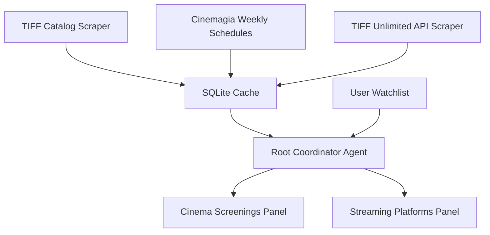

# Festival: To Be Continued... 🎬🍿

A personal concierge agent and dashboard that helps film festival-goers track when and where their missed festival movies are played again in local cinemas or online streaming platforms.

---

## 📖 The Problem
Film festivals (like the Transilvania International Film Festival - TIFF) screen hundreds of films over a single week, making it physically impossible to watch them all. Once the festival ends, these niche, independent, and international films are highly scattered. Finding if, when, and where they are screened again (either at local independent cinemas or on streaming platforms) requires constant, manual, and tedious web-searching across multiple languages and provider catalogs.

## 💡 The Solution
**Festival: To Be Continued...** solves this problem by acting as a personal film concierge. The application features:
1.  **Watchlist Management**: Track specific films directly from the parsed festival catalog.
2.  **Theatrical & Streaming Crawlers**: Concurrently scrapes local independent cinemas (Cinema Victoria, Cinema Arta, Cinema Florin Piersic via Cinemagia schedules) and online streaming platforms (TIFF Unlimited storefront API & Netflix watch providers).
3.  **Cross-Lingual Reconciler (Gemini)**: Uses Gemini 2.5 Flash to semantically map watchlists (e.g. English titles) against showtimes presented in other languages (e.g. Romanian or Hungarian).
4.  **Premium Glassmorphism Dashboard**: A dual-column overview grid displaying theatrical screenings and streaming availabilities side-by-side with active "Watch Now" and ticketing links.

---

## 🏛️ Agent Architecture & Key Concepts
This project demonstrates **four key concepts** covered in the AI Agents course:

### 1. Multi-Agent System (using ADK)
The system is built as a team of collaborative agents orchestrated via the **Agent Development Kit (ADK)**:
*   **Curator Agent**: Manages the TIFF Film Catalog, scraping details (director, country, running time) concurrently and maintaining caches.
*   **Cinema Watcher Agent**: Gathers schedules and showtimes from local Cluj-Napoca cinemas.
*   **Root Coordinator Agent**: Manages the user's watchlist, triggers semantic cross-lingual matching, and presents matched cinema/streaming options.



### 2. Agent Skills
*   **Fuzzy Translation Mapping**: Resolves cross-lingual title naming (e.g. matching *"Feels Like Home"* with *"Itt érzem magam otthon"*).
*   **Concurrent Detail Fetching**: Uses `ThreadPoolExecutor` workers to resolve page details (duration, country) in parallel.

### 3. Security & Privacy
*   **Local Storage**: Watchlist and cache data are stored in local JSON files (`data/watchlist.json` and `data/parsed_cache.json`), protecting user privacy.
*   **API Credentials**: Keeps API keys isolated in environment variables (`.env`), preventing credential exposure.

### 4. Deployability
*   The application includes a standard `Dockerfile` allowing the entire FastAPI server and static frontend to be packaged and run in any containerized environment.

---

## 📂 Project Structure
```
festival-tbc/
├── app/
│   ├── static/             # Frontend Dashboard (HTML, CSS, JS)
│   ├── agent.py            # ADK Agent definition
│   ├── fast_api_app.py     # FastAPI Server and endpoints
│   ├── tools.py            # Scraping and reference lookup engines
│   └── watchlist_store.py  # JSON watchlist and cache manager
├── tests/                  # Integration tests
├── Dockerfile              # Containerization script
├── capstone-submission.md  # Hackathon grading rubric
└── pyproject.toml          # Project dependencies
```

---

## 🚀 Setup & Execution

### Prerequisites
1.  Python 3.11+
2.  `uv` package manager: [Install uv](https://docs.astral.sh/uv/getting-started/installation/)
3.  `google-agents-cli`: Install with `uv tool install google-agents-cli`

### Installation
1.  Clone the repository and install dependencies:
    ```bash
    uv pip install -e .
    ```
2.  Set up your environment variables by copying `.env.example` to `.env`:
    ```bash
    cp .env.example .env
    ```
    Open `.env` and fill in your Gemini API key (and optionally your TMDB key for live watch provider queries):
    ```env
    GEMINI_API_KEY=your_gemini_api_key
    GOOGLE_CLOUD_PROJECT=your_google_cloud_project
    TMDB_API_KEY=your_tmdb_api_key
    ```

### Running the App
Start the FastAPI server locally:
```bash
uv run uvicorn app.fast_api_app:app --host 127.0.0.1 --port 8080
```
Open **`http://127.0.0.1:8080/dashboard/`** in your browser to experience the premium interface.
