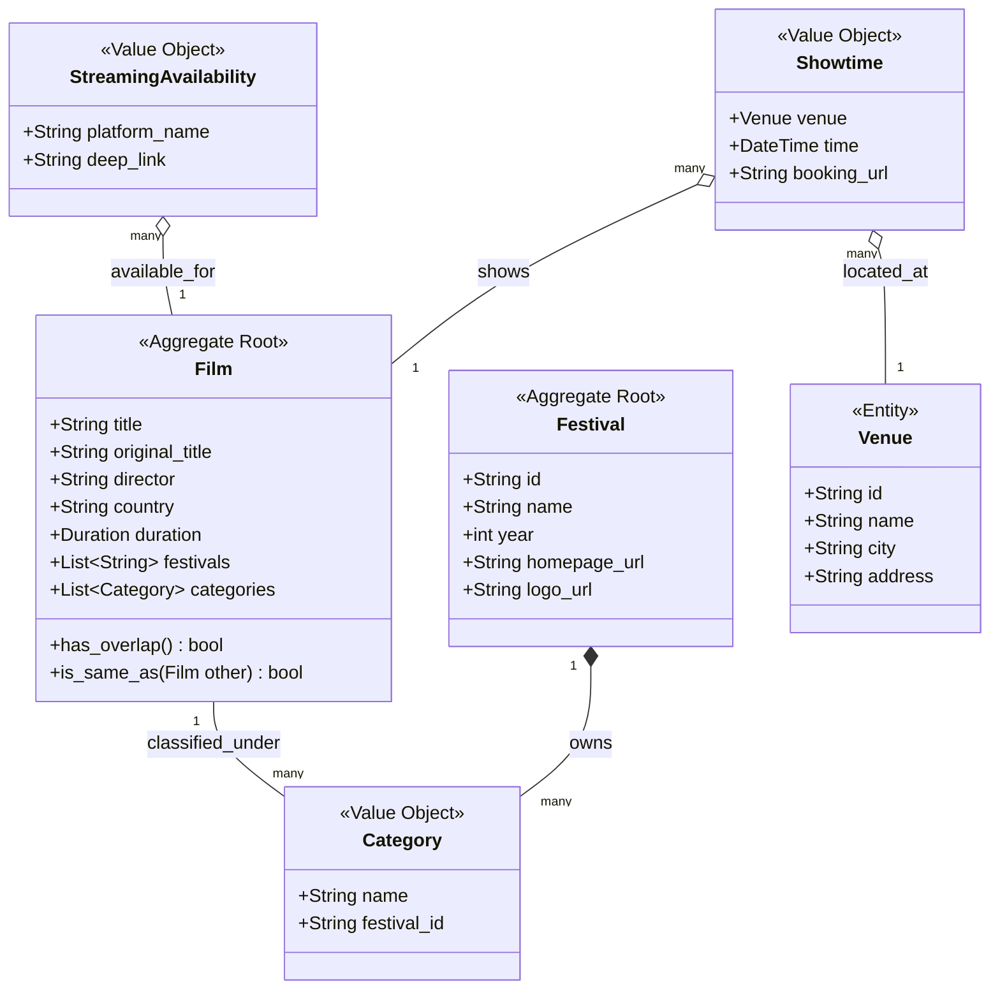

# Domain-Driven Design (DDD) Architecture Guide

This guide details how the core domain entities of **Festival: To Be Continued...** are currently defined, identifies the limitations of the current representation, and proposes a formal Domain-Driven Design (DDD) model refactoring.

---

## Current Implicit Representations

Currently, because the project was built as a rapid prototype, the domain entities are represented **implicitly** as raw Python dictionaries (`dict[str, Any]`) passed between scrapers, API endpoints, and cache files. 

### 1. Film
*   **Representation**: A dictionary generated by `tools.py` scrapers and merged by `/api/films`.
*   **Structure**:
    ```python
    {
        "title": "Amarga Navidad",
        "original_title": "Amarga Navidad",
        "director": "Pedro Almodovar",
        "category": "Supernova / In Competition",
        "duration": "111 min",
        "description": "Official selection...",
        "link": "https://tiff.ro/en/festival/2026/amarga-navidad",
        "country": "Spain",
        "festivals": ["Cannes", "TIFF"]
    }
    ```

### 2. Festival
*   **Representation**: Implicitly represented as string tags inside lists (e.g., `["TIFF", "Cannes"]`) and query parameters (`?festival=cannes`).

### 3. Category
*   **Representation**: A simple string category value (e.g., `"Competition"`) associated directly with a film card or parsed section headers.

### 4. Venue (Cinema)
*   **Representation**: Handled as a string property inside showtime results.
*   **Structure**:
    ```python
    {
        "title": "Titanic Ocean",
        "cinema": "Cinema Victoria",
        "date": "Vineri, 3 Iulie",
        "time": "18:00",
        "link": "https://www.cinemagia.ro/..."
    }
    ```

### 5. Streaming Platform
*   **Representation**: Implicitly defined as string properties (e.g., `"Netflix"`, `"TIFF Unlimited"`) inside streaming showtime checks.

---

## Limitations of Current Representation

1.  **No Type Safety or Validation**: Dictionary keys can easily be misspelled (e.g. `"durations"` vs `"duration"`), causing silent UI failures or runtime `KeyError` exceptions.
2.  **Scraping Tight-Coupling**: The domain model is directly shaped by the raw data returned by Wikipedia or Cinemagia scrapers. If a scraper changes, the business logic breaks.
3.  **Missing Domain Logic Encapsulation**: Behaviors (such as checking if a movie is a crossover, normalization of titles, or formatting times) are implemented as utility functions in `fast_api_app.py` rather than being contained inside the entities themselves.

---

## Proposed DDD Refactored Architecture

In Domain-Driven Design, the codebase is structured around **Entities**, **Value Objects**, **Aggregate Roots**, and **Repositories** to ensure clear boundaries and robust validation.

### Domain Model Relationships



---

## Code Implementations of Domain Models

Here is how the proposed models can be implemented cleanly using standard Python `dataclasses` (or Pydantic) to maintain zero dependencies:

### 1. Value Objects (`Category`, `Duration`, `StreamingPlatform`)
Value Objects are immutable, compared by value rather than identity, and carry no ID.

```python
from dataclasses import dataclass

@dataclass(frozen=True)
class Category:
    name: str
    festival_id: str  # Contextual to a festival (e.g. 'tiff', 'cannes')

@dataclass(frozen=True)
class StreamingPlatform:
    name: str  # e.g., 'Netflix', 'TIFF Unlimited'
    deep_link: str
    is_active: bool = True

@dataclass(frozen=True)
class FilmSelection:
    """Value Object representing a film's specific selection details at a festival."""
    festival_id: str  # e.g., 'tiff', 'cannes', 'berlinale'
    category: Category
    link: str  # Festival-specific film details or ticket booking page
    description: str  # Festival-specific synopsis
```

### 2. Entities & Aggregate Roots (`Film`, `Festival`, `Venue`)
Entities have unique identifiers (`id`) and encapsulate their own lifecycle behaviors.

```python
from typing import List, Optional
import re

@dataclass
class Film:
    title: str
    director: str
    original_title: str
    country: str
    duration_min: int  # Stored as standard integer minutes
    selections: List[FilmSelection]  # Holds distinct selections for all selected festivals
    imdb_url: Optional[str] = None
    tmdb_id: Optional[str] = None

    @property
    def identity(self) -> str:
        """Determines the domain identity string based on title and director."""
        title_norm = re.sub(r"[^\w\s]", "", self.title.lower()).strip()
        dir_norm = re.sub(r"[^\w\s]", "", self.director.lower()).strip() if self.director else "unknown"
        return f"{title_norm}::{dir_norm}"

    @property
    def festivals(self) -> List[str]:
        """Dynamically retrieves the list of festivals from the selections."""
        return [sel.festival_id for sel in self.selections]

    def is_same_as(self, other: "Film") -> bool:
        """Domain logic to evaluate film equivalence (fuzzy & ID checks)."""
        if self.imdb_url and other.imdb_url and self.imdb_url == other.imdb_url:
            return True
        if self.tmdb_id and other.tmdb_id and self.tmdb_id == other.tmdb_id:
            return True
        return self.identity == other.identity

    def add_selection(self, new_selection: FilmSelection):
        """Merges a new festival selection into this film entity."""
        if new_selection.festival_id not in self.festivals:
            self.selections.append(new_selection)

@dataclass
class Festival:
    id: str  # e.g. 'cannes-2026'
    name: str  # e.g. 'Cannes Film Festival'
    year: int
    logo_svg_path: str
    homepage_url: str

@dataclass
class Venue:
    id: str  # e.g. 'cinema-victoria'
    name: str
    city: str = "Cluj-Napoca"
    address: Optional[str] = None
```

### 3. Repositories (`FilmRepository`, `WatchlistRepository`)
Repositories abstract data access/storage, separating the domain model from database drivers, file systems, or crawlers.

```python
from abc import ABC, abstractmethod

class FilmRepository(ABC):
    @abstractmethod
    def find_all(self, festival_id: Optional[str] = None) -> List[Film]:
        """Loads and returns all film entities."""
        pass

    @abstractmethod
    def find_intersections(self) -> List[Film]:
        """Calculates and returns films appearing in multiple festivals."""
        pass

class WatchlistRepository(ABC):
    @abstractmethod
    def get_watchlist(self) -> List[Film]:
        pass

    @abstractmethod
    def add(self, film: Film) -> bool:
        pass

    @abstractmethod
    def remove(self, title: str) -> bool:
        pass
```

## Scrapers vs. Repositories in DDD

In Domain-Driven Design, **Scrapers are NOT considered Repositories**. Instead, they are classified as **Gateways** or **Data Sources** belonging to the **Infrastructure Layer**.

Here is how they differ and interact:

### 1. The Scraper as an Infrastructure Gateway
A scraper (e.g., `TiffScraper`, `CannesScraper`) deals directly with HTTP connections, header parameters, DOM parsing, and HTML structure. It does not understand business logic or domain invariants. It is a "raw" data driver.

### 2. The Repository as a Domain Interface
The `FilmRepository` is a domain-level collection interface. The application code queries the repository (e.g., `film_repo.find_all()`) and expects to receive clean, validated **Film** and **Festival** entities. 

### 3. The Anti-Corruption Layer (ACL)
By placing the repository between your controllers/services and the scrapers, you create an **Anti-Corruption Layer (ACL)**:
*   The Scraper fetches the raw, messy external HTML/JSON data.
*   An infrastructure implementation of `FilmRepository` (e.g., `ScrapedFilmRepository`) calls the scraper to get raw inputs.
*   The Repository translates this raw format into clean domain models (`Film`).
*   If a festival site changes its HTML layout, only the scraper changes. The domain entity (`Film`) and the API controllers remain completely untouched.

```
+------------------+      +-------------------+      +-------------------+
|  API Controller  | ---> |  FilmRepository   | ---> |  TiffScraper      |
|  (App Layer)     |      |  (Domain Interface|      |  (Infrastructure  |
|                  |      |   & Translation)  |      |   Gateway/ACL)    |
+------------------+      +-------------------+      +-------------------+
                                   |
                                   v
                          +-------------------+
                          |    Film Entity    |
                          |  (Domain Model)   |
                          +-------------------+
```

---

## Architectural Impact

Transitioning the codebase to this DDD structure would achieve several key benefits:
1.  **Isolates Scrapers (Anti-Corruption Layer)**: Scrapers translate raw crawled HTML into formal `Film` and `Festival` entity instances before returning them, protecting the rest of the application from site changes.
2.  **Clean APIs**: Controller routes in `fast_api_app.py` simply invoke Repository interfaces, keeping endpoints thin, readable, and highly testable.
3.  **Strict Domain Validation**: If a scraper parses an invalid film record (e.g. missing a title), the object fails construction during domain validation, rather than crashing downstream client components.
