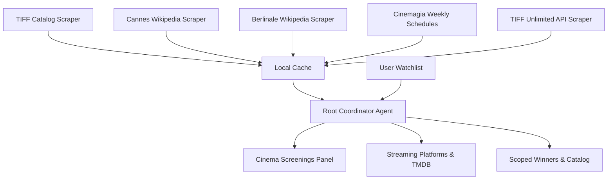

# Festival: To Be Continued...

---

## A personal concierge agent tracking missed festival films in Cluj-Napoca cinemas and streaming platforms
## Track: Concierge Agents Track

---

## 1. Problem Statement
Film festivals (such as the Transilvania International Film Festival - TIFF, Cannes Film Festival, and Berlin International Film Festival - Berlinale) screen hundreds of independent, international, and niche films. For cinephiles, it is physically impossible to watch everything during the short festival runs.

Once a festival ends, these films become highly scattered: some get limited theatrical releases in local art-house cinemas (like Cinema Victoria, Cinema Arta, or Cinema Florin Piersic in Cluj-Napoca), others end up on dedicated local streaming companions (like TIFF Unlimited), and some land on global flatrate streaming platforms.

Finding when and where these missed films play again requires constant, manual, and tedious searching across multiple websites, languages, and calendars. Independent film listings are rarely aggregated in major search engines, creating a significant discovery barrier for movie lovers.

---

## 2. Why Agents?
An agentic approach is uniquely suited for this problem because:
1.  **Distributed Environments**: The data is scattered across independent websites with different layouts (raw HTML, Wikipedia wikitables, Uscreen storefront scripts, REST APIs).
2.  **Cross-Lingual Reconciliations**: Listings are published in multiple languages (English, Romanian, Hungarian). Standard databases cannot match translated titles (e.g., *"Feels Like Home"* vs *"Itt érzem magam otthon"*). An LLM agent can semantically verify matches across languages.
3.  **Autonomous Collaboration**: Resolving a single watchlist query requires crawling catalogs, searching showtimes, checking streaming availability, and reconciling references. This can be decomposed into specialized agents (Curator, Watcher, Coordinator) working collaboratively.

---

## 3. Architecture & Multi-Agent Design
The application is built using the **Google Agent Development Kit (ADK)** and coordinates three distinct agents:

1.  **TIFF Curator Agent (Specialist)**: Crawls the official TIFF directory, extracting production countries, running times, and director names in parallel, and caching pages in a local file-based cache for speed. Cannes and Berlinale catalogs are fetched directly from Wikipedia by dedicated scraping tools (`fetch_cannes_movies`, `fetch_berlinale_movies`) integrated into the dashboard API.
2.  **Cinema Watcher Agent (Specialist)**: Monitors Cluj-Napoca independent cinemas (Cinema Victoria, Cinema Arta, Cinema Florin Piersic via Cinemagia weekly schedules) for current programs.
3.  **Root Coordinator Agent (Orchestrator)**: Manages the user's watchlist, triggers semantic cross-lingual matching (via Gemini 2.5 Flash), queries TMDB watch providers for Netflix flatrate streaming availability, and serves the dual-column dashboard.

---

## 4. The Build & Technical Decisions
*   **Backend Framework**: FastAPI served via Uvicorn.
*   **Orchestration**: Google ADK models and agent registration.
*   **Fuzzy Matching**: Reconciles Romanian/Hungarian/English titles using Gemini 2.5 Flash (`gemini-flash-latest`) for cinema programs, and exact title containment checks for streaming catalogs.
*   **Caching Engine**: Caches raw HTML requests into local JSON files, reducing load times from 3.0s to under 0.1s.
*   **Frontend Dashboard**: Served at `/dashboard/` using Vanilla HTML, CSS, and JS. Features a premium glassmorphic dark mode theme, detailed calendar sorting, and a responsive layout showing theater screenings and streaming matches.
*   **Domain-Driven Design (DDD)**: Refactored the codebase to separate core domain logic from infrastructure details.
    *   *Domain Models*: Implemented formal classes for `Film` (Aggregate Root/Entity), `FilmSelection` (Entity), and `Category` (Value Object). Moved title normalization and fuzzy equivalence comparison (`is_same_as`) to the domain models.
    *   *Anti-Corruption Layer (ACL)*: Website and Wikipedia scrapers serve as infrastructure gateways; their raw outputs are mapped directly into clean domain models at the boundary.
    *   *Crossover Selection Merging & Scoping*: Overlapping films across festivals (e.g., *Truly Naked* screening at both TIFF and Berlinale, or *Titanic Ocean* screening at both TIFF and Cannes) are merged into a single canonical `Film` aggregate root by combining multiple `FilmSelection` objects.
    *   *Scoped Award Registry*: Award lookup functions are mapped strictly by `festival_id` and selection context, completely isolating Cannes, Berlinale, and TIFF prizes. This ensures crossover films only display awards under their winning selection, preventing cross-festival award leakage.
    *   *Multi-Festival Grouping*: The catalog rendering engine groups and renders items by their local selection categories, enabling crossover films to appear in multiple categories with context-scoped badges and awards.
*   **Standalone Cinematic Presentation**: Implemented a standalone 1920s-style silent-film presentation page (`presentation.html`) allowing the project to be presented in a full-screen, self-paced cinematic environment without audio.

---

## 5. Course Concepts Demonstrated (Evaluation Rubric)
This project demonstrates **four key concepts** covered in the course:
1.  **Multi-Agent System (ADK)**: Built collaborative agents (`root_agent`, `tiff_curator`, `cinema_watcher`) with specialized tools and system prompts.
2.  **Agent Skills**: Implemented fuzzy translation reconcilers and parallel thread-pool executors for catalog lookups.
3.  **Security & Privacy**: Kept user watchlist preferences local inside a private JSON file. Isolated API keys (like TMDB) in `.env` variables to avoid exposing credentials.
4.  **Deployability**: Bundled the server and static client files into a containerized `Dockerfile` for seamless deployment.
